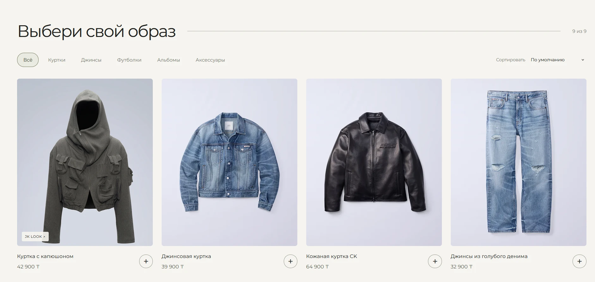

# JKCOLLECTION

An online clothing store I built with Flask. It has a product catalog with
filters and a cart, user accounts with avatars, and a section where logged-in
users post their own outfits. It runs as three containers: PostgreSQL,
Gunicorn and Nginx.

I wanted to take one project all the way: from models and forms to a Docker
setup and a deploy I could actually open in a browser. The site's theme is
built around Jungkook's style. This is a fan project and has no connection to
him, BTS or any of the brands shown.

The interface is in Russian.


| Catalog | Registration |
|---------|--------------|
|  |  |

## What it does

- **Catalog**: category filters, sorting, a product card with size selection.
  The cart is kept in `localStorage`, so it survives a page reload.
- **Accounts**: registration, login, "remember me", avatar upload (JPG/PNG).
  Passwords are hashed with bcrypt.
- **Outfit posts**: logged-in users can create, edit and delete their own
  posts. Trying to edit someone else's post returns 403.

## Stack

Python 3.12, Flask 3, SQLAlchemy 2, Flask-Login, Flask-WTF, Flask-Migrate
(Alembic), Flask-Assets, PostgreSQL, Jinja2, Bootstrap, plain JavaScript,
Gunicorn, Nginx, Docker Compose.

## Running locally

### Docker (recommended)

```bash
git clone https://github.com/KairollaAkniet/jkcollection.git
cd jkcollection
cp .env.example .env
```

In `.env`, set `POSTGRES_PASSWORD` and `SECRET_KEY` at minimum. To generate a
key:

```bash
python -c "import secrets; print(secrets.token_hex(32))"
```

Start everything:

```bash
docker compose up -d --build
```

Then open <http://127.0.0.1:8080>. The database isn't exposed outside the
Compose network.

To stop it, run `docker compose down`. Don't add `-v` unless you want to wipe
the database and uploaded avatars.

### Without Docker

You'll need Python 3.12 and a running PostgreSQL. Note that the default port
in `.env.example` is `5532`, not the usual `5432`, so change it if needed.

```bash
python -m venv .venv
source .venv/bin/activate
pip install -r requirements.txt
cp .env.example .env
flask --app app:create_app run --debug
```

Tables are created on first start. If you change the models, use migrations:

```bash
flask --app app:create_app db migrate -m "add something"
flask --app app:create_app db upgrade
```

## Environment variables

| Variable | Purpose |
|----------|---------|
| `SECRET_KEY` | Required. The app won't start without it. |
| `POSTGRES_USER` / `POSTGRES_PASSWORD` / `POSTGRES_DB` | Database credentials |
| `POSTGRES_HOST` / `POSTGRES_PORT` | Database address for local runs. Compose sets these itself. |
| `DATABASE_URL` | Full connection string. Overrides the `POSTGRES_*` values. |
| `WEB_BIND` / `WEB_PORT` | Where Nginx is published. Default is `127.0.0.1:8080`. |
| `COOKIE_SECURE` | Set to `true` behind HTTPS |
| `PORT` | Gunicorn port inside the container. Default is `8080`. |

## Project structure

```
app/
├── __init__.py      # create_app(), blueprint registration
├── config.py        # all settings read from the environment
├── extensions.py    # db, migrate, login_manager, assets
├── forms.py
├── bundles.py       # CSS/JS bundles for Flask-Assets
├── models/          # User, Post
├── routes/          # user.py, post.py
├── templates/
└── static/
migrations/          # Alembic
nginx/               # Nginx config and image
run.py               # entry point for Gunicorn (run:application)
```

## Notes on a few decisions

- **Config comes only from the environment.** There are no secrets in the
  repository, and the app refuses to start without `SECRET_KEY` instead of
  quietly using a weak default.
- **Cookies**: `HttpOnly` and `SameSite=Lax` are always on. `Secure` is
  switched on with a variable so local runs over HTTP still work.
- **The container doesn't run as root.** The Dockerfile creates a separate
  `appuser`.
- **Nginx in front of Gunicorn** serves static files and buffers slow clients,
  so Gunicorn stays free for real requests.
- **`DATABASE_URL`** was added for hosting. Render and Neon provide a single
  connection string, and the app normalizes `postgres://` to the right driver.

## Deploy

I tested it on Render (Docker web service) with Neon (Postgres). Both have a
free tier.

1. In Neon, create a database and copy the connection string with
   `sslmode=require`.
2. In Render, create a Web Service from this repository. Choose the Docker
   runtime and set the health check path to `/`.
3. Add these variables: `DATABASE_URL`, `SECRET_KEY`, `COOKIE_SECURE=true`,
   `FLASK_DEBUG=0`.

One caveat: the disk on Render's free plan is wiped on every restart, so
uploaded avatars disappear. Product images are part of the repository and
aren't affected.

## What's missing and what's next

To be honest about the current state:

- The products live in `app/static/js/app.js`, not in the database, and the
  prices are placeholders.
- The cart is client-side only. There's no checkout or payment.
- Uploads are stored on local disk.
- There are no tests.

Roughly in order, I plan to:

- [ ] Move products into PostgreSQL and add an admin page for them
- [ ] Store the cart on the server for logged-in users
- [ ] Move uploads to S3-compatible storage
- [ ] Write pytest tests for authentication and post permissions
- [ ] Set up CI with GitHub Actions (lint + tests)
- [ ] Make deletion POST-only and protect it with CSRF

## License

No license has been chosen yet, so all rights are reserved.
