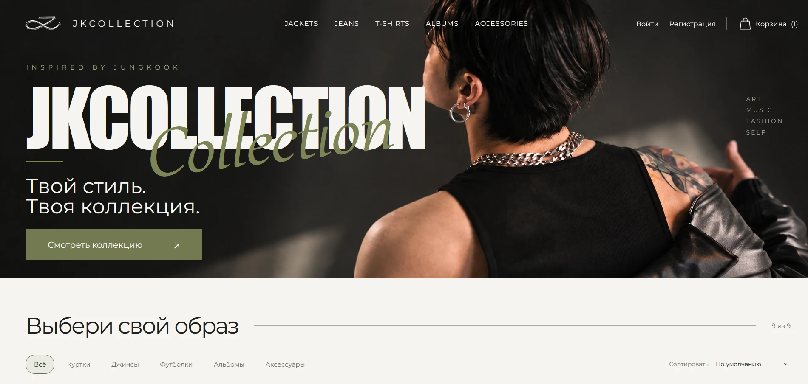
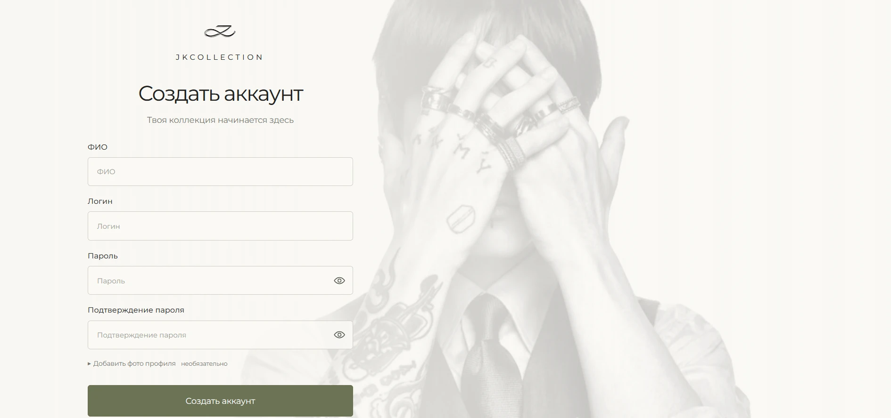

# JKCOLLECTION

A small fashion storefront built with Flask. It has a product catalog with a
client-side shopping cart, user accounts with avatars, and authenticated CRUD
for outfit posts. The stack runs behind Nginx and Gunicorn and ships with a
Docker Compose setup for local use and a Dockerfile for hosted deployment.

The UI is in Russian. The visual concept is inspired by Jungkook; this is a
fan project and is not affiliated with him, BTS or any brand shown.

## Screenshots



| Catalog | Registration |
|---------|--------------|
|  |  |

## Features

- Product catalog with category filters, sorting, a detail dialog, size selection and a cart that persists
  in `localStorage`
- Registration and login with bcrypt-hashed passwords and "remember me"
- Avatar upload (JPG/PNG, 5 MB request limit)
- Outfit posts: create, edit and delete for logged-in users
- CSRF protection on forms (Flask-WTF), HttpOnly / SameSite session cookies,
  optional `Secure` flag for HTTPS
- Schema migrations with Alembic via Flask-Migrate
- Static asset bundling and minification with Flask-Assets

## Tech stack

| Layer       | Tools                                              |
|-------------|----------------------------------------------------|
| Backend     | Python 3.12, Flask 3, SQLAlchemy 2, Flask-Login    |
| Database    | PostgreSQL (psycopg2), Alembic migrations          |
| Frontend    | Jinja2 templates, Bootstrap, vanilla JavaScript    |
| Serving     | Gunicorn behind Nginx                              |
| Packaging   | Docker, Docker Compose                             |

## Project layout

```
.
├── app/
│   ├── __init__.py        # application factory
│   ├── config.py          # configuration from environment variables
│   ├── extensions.py      # db, migrate, login manager, assets
│   ├── forms.py           # WTForms (registration, login)
│   ├── bundles.py         # asset bundles
│   ├── models/            # User, Post
│   ├── routes/            # user and post blueprints
│   ├── templates/
│   └── static/            # css, js, images, uploads
├── migrations/            # Alembic environment and versions
├── nginx/                 # Nginx image and config
├── Dockerfile
├── docker-compose.yaml
├── run.py                 # WSGI entry point (run:application)
└── requirements.txt
```

## Getting started

### With Docker

Requires Docker with the Compose plugin.

```bash
git clone https://github.com/KairollaAkniet/jkcollection.git
cd jkcollection
cp .env.example .env
```

Edit `.env` and set at least `POSTGRES_PASSWORD` and `SECRET_KEY`. A key can be
generated with:

```bash
python -c "import secrets; print(secrets.token_hex(32))"
```

Then start the stack:

```bash
docker compose up -d --build
```

The site is available at <http://127.0.0.1:8080>. PostgreSQL is only reachable
inside the Compose network.

```bash
docker compose logs -f flask nginx   # logs
docker compose down                  # stop, keep volumes
```

Do not pass `-v` to `down` unless you want to delete the database and uploaded
files.

### Without Docker

Requires Python 3.12 and a running PostgreSQL instance.

```bash
python -m venv .venv
source .venv/bin/activate
pip install -r requirements.txt
cp .env.example .env     # set POSTGRES_* to match your local database
flask --app app:create_app run --debug
```

Tables are created automatically on first start. When changing models, generate
a migration instead of relying on that:

```bash
flask --app app:create_app db migrate -m "describe the change"
flask --app app:create_app db upgrade
```

## Configuration

All settings come from environment variables (`.env` is loaded by `run.py`).

| Variable                                    | Description                                                        |
|---------------------------------------------|--------------------------------------------------------------------|
| `SECRET_KEY`                                | Required. The app refuses to start without it.                     |
| `POSTGRES_USER`, `POSTGRES_PASSWORD`, `POSTGRES_DB` | Database credentials.                                      |
| `POSTGRES_HOST`, `POSTGRES_PORT`            | Database address for local runs. Compose overrides these.          |
| `DATABASE_URL`                              | Full connection URL. Takes precedence over the `POSTGRES_*` values.|
| `WEB_BIND`, `WEB_PORT`                      | Host interface and port Nginx is published on (default `127.0.0.1:8080`). |
| `COOKIE_SECURE`                             | Set to `true` when serving over HTTPS.                             |
| `PORT`                                      | Port Gunicorn listens on inside the container (default `8080`).    |

## Deployment

The `Dockerfile` in the repository root is what hosted platforms build;
`docker-compose.yaml` is intended for local and single-server use.

A free-tier setup that works: a Docker web service on Render plus a Neon
PostgreSQL database.

1. Create the Neon project and copy the connection string (with
   `sslmode=require`).
2. On Render, create a Web Service from this repository with runtime Docker and
   health check path `/`.
3. Set `DATABASE_URL`, `SECRET_KEY`, `COOKIE_SECURE=true` and `FLASK_DEBUG=0` as
   environment variables.

Note that the local filesystem on free Render instances is ephemeral, so
uploaded avatars do not survive a restart. Product images are part of the
repository and are not affected.

If you expose the Compose stack directly on a server, set `WEB_BIND=0.0.0.0`
and terminate TLS in front of it before enabling `COOKIE_SECURE`.

## Known limitations

- The product catalog is defined in `app/static/js/app.js`, not in the database,
  and prices are placeholders.
- The cart lives in the browser only. There is no checkout or payment.
- Uploaded files are stored on local disk. Moving to object storage (S3 or
  similar) is the obvious next step for hosted deployments.
- There is no automated test suite yet.

## License

No license has been chosen yet; all rights reserved by the author.
